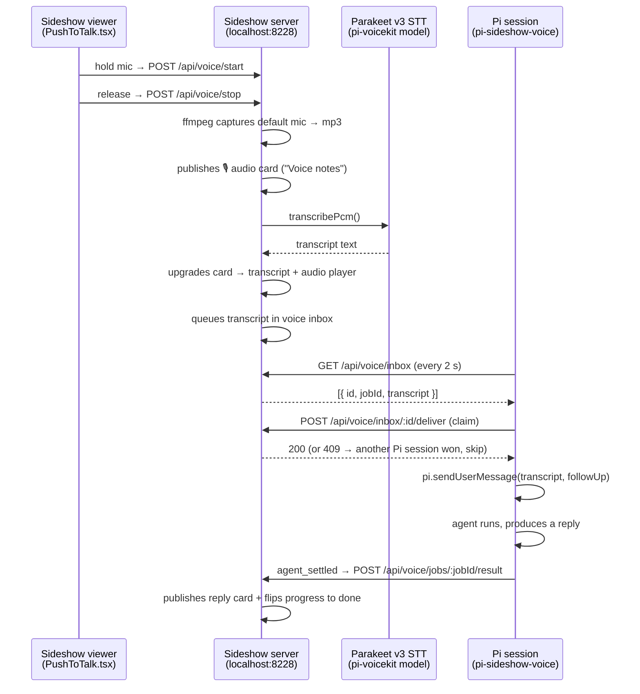

# pi-sideshow-voice

A [Pi](https://pi.dev) extension that closes the loop on **sideshow** push-to-talk: it
delivers browser voice-note transcripts into the Pi agent — and ships the agent's reply
back to the sideshow web UI as a card next to your voice note.

Press-and-hold the mic button in the sideshow session header, speak, let go. A few
seconds later the agent has answered, and the answer is on the board.

## How the pieces work together

Three components cooperate, each in its own repo/package:



1. **Sideshow viewer + server** (the [`sideshow`](https://github.com/modem-dev/sideshow) repo)
   - `viewer/src/PushToTalk.tsx` — the hold-to-talk button in the session header. Holding it
     calls `POST /api/voice/start`; releasing calls stop. Server-side `server/voice.ts`
     records the default microphone with ffmpeg (the browser never touches the mic, so no
     permission prompts per tab).
   - `server/app.ts` voice routes — on stop, the server immediately publishes an
     *audio card* to a "Voice notes" session (the take is on the board while the slow work
     runs), then transcribes the PCM with `server/stt.ts`.
   - `server/stt.ts` — local speech-to-text that **mirrors pi-voicekit**: it `require`s the
     pi-voicekit package's sherpa recognizer and runs the same Parakeet v3 model
     (`~/.pi/models/parakeet-v3`) with the same transducer config pi-voicekit builds.
     Transcripts come from the laptop, not the cloud.
   - Once transcribed, the card is upgraded to *transcript + player* and the transcript is
     queued in the server's in-memory **voice inbox**. `viewer/src/VoiceProgress.tsx` polls
     the job and drives the card's footer progress (loading → transcribing → done).

2. **pi-sideshow-voice** (this repo) — the bridge between the inbox and the agent.
   - Polls `GET /api/voice/inbox` every 2 s.
   - **Claims before sending**: `POST /api/voice/inbox/:id/deliver` is first-POST-wins; a
     second concurrent Pi session gets `409` and skips, so each transcript reaches exactly
     one session. The claim also doubles as delivery.
   - Delivers via `pi.sendUserMessage(transcript, { deliverAs: "followUp" })` — the exact
     call pi-voicekit's auto-submit-on-speak uses in the terminal, so the transcript lands
     like a normal user message (retries 3× with backoff before warning).
   - **Result round-trip**: the extension remembers the voice job id, watches
     `message_end` for the latest assistant text, and on `agent_settled` posts the final
     reply to `POST /api/voice/jobs/:id/result`. The server publishes it as a new card next
     to the voice note and flips the progress to done. If no reply was produced (e.g. the
     agent was mid-turn on something else), nothing is posted — the note keeps its text.
     If Pi claims but never answers, the server times the job out after 5 minutes so the
     spinner never hangs.

3. **pi-voicekit** (upstream pi package, *unchanged*) — provides the sherpa-based
   recognizer code and the local Parakeet v3 model. Sideshow's STT deliberately reuses
   rather than reimplements, so terminal push-to-talk and browser push-to-talk share one
   engine and one model on the laptop.

## Install

Requires a running local sideshow server (≥ the push-to-talk release) and the
pi-voicekit Parakeet model on disk (`~/.pi/models/parakeet-v3` — run pi-voicekit once to
download it).

```sh
# from a clone
pi install ./pi-sideshow-voice

# or straight from git
pi install git:github.com/Sandoulinou/pi-sideshow-voice
```

## Configuration

| Env var       | Default                 | Purpose                          |
| ------------- | ----------------------- | -------------------------------- |
| `SIDESHOW_URL` | `http://127.0.0.1:8228` | Base URL of the local server    |

No auth token by default — the local server runs without auth, mirroring how the viewer
talks to it.

## Notes

- One Pi process = one poller; multiple concurrent Pi sessions are safe (claim/409).
- The extension is read-mostly: it only reads the inbox, posts results, and sends user
  messages. It never mutates sessions or posts directly.
- If the sideshow server is down, polls fail silently and retry on the next tick.
